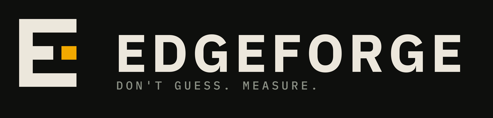
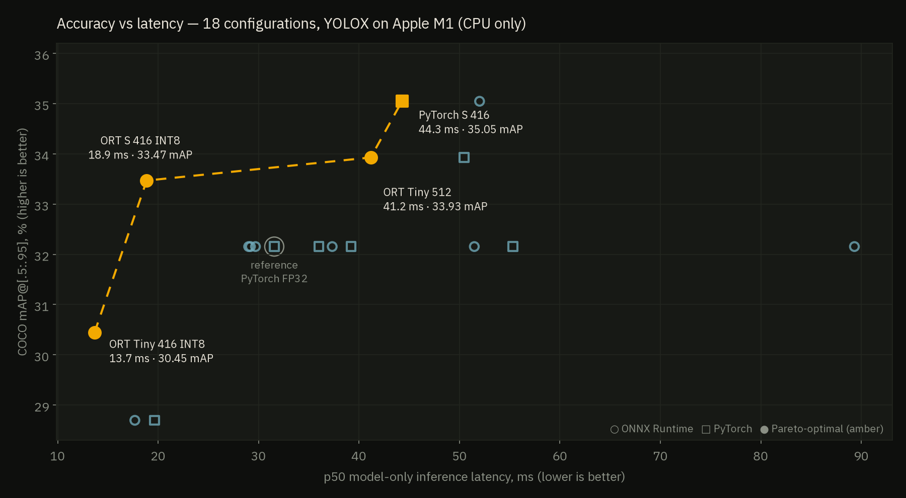
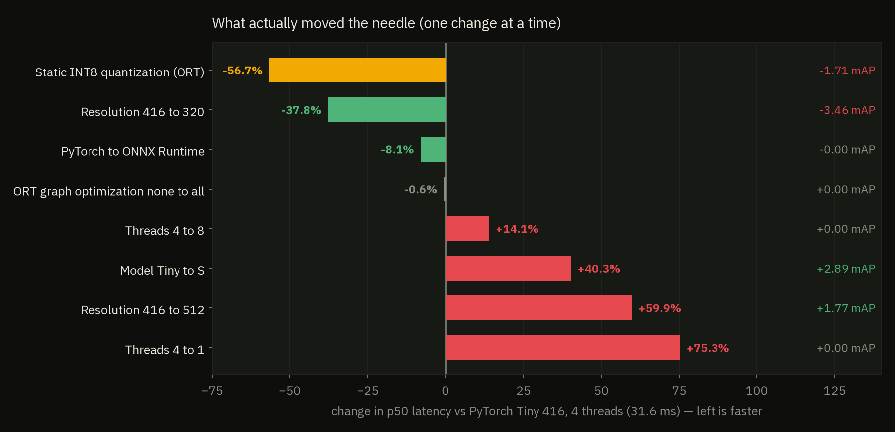
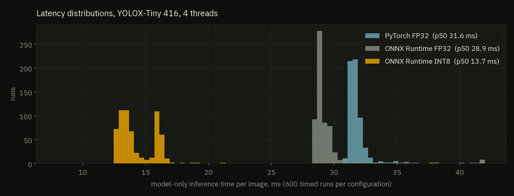
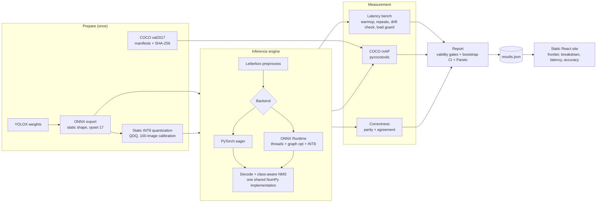
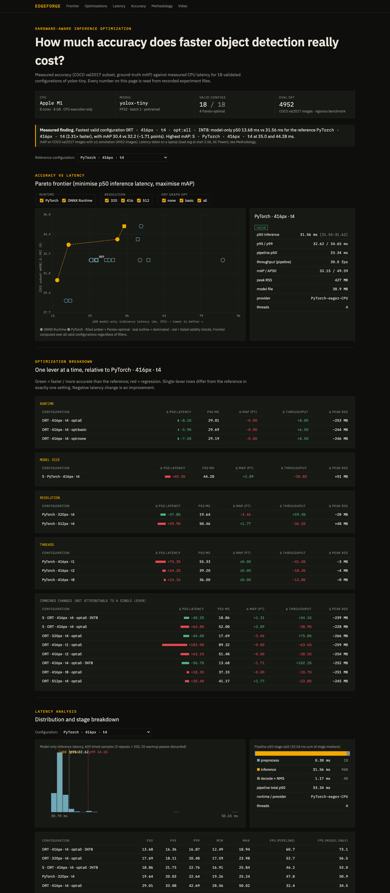

<div align="center">



### How much detection accuracy do you give up for every millisecond you save?

**EdgeForge** is a CPU-only, $0 benchmarking lab that answers that question with measurements instead of guesses:
it runs real object detectors under many execution configurations, scores each against COCO ground truth,
times it rigorously, and maps the accuracy-latency trade-off as a Pareto frontier.

[](https://github.com/DMgaming00/EdgeForge/actions/workflows/ci.yml)


</div>

---

## The headline

On an Apple M1 (8 GB, CPU only), every number below is measured, not claimed:

| Finding | Evidence |
|---|---|
| **Static INT8 cut inference latency by 52.9% on ONNX Runtime** (29.01 ms to 13.68 ms, 2.1x) | for **-1.71 COCO mAP points** (32.15 to 30.45) on all 4,952 annotated val2017 images |
| **INT8 YOLOX-S beats FP32 YOLOX-Tiny on both axes** | 18.86 ms vs 29.01 ms *and* 33.47 vs 32.15 mAP |
| **Returns on latency are very uneven** | along the Pareto frontier, each extra millisecond buys +0.58, then +0.02, then +0.36 mAP points |
| **Graph optimization barely mattered for latency** | 29.19 / 29.69 / 29.01 ms for none / basic / all, even though it fuses the graph from 324 to 197 nodes |
| **More threads is not always faster on Apple silicon** | 4 threads beat 8 for both runtimes on the 4 performance + 4 efficiency core M1 |



> The reference (PyTorch FP32 YOLOX-Tiny, 416 px) scores **32.15% mAP**, in line with the published ~32.8%, so the pipeline is not broken.
> Every claim here comes from `site/public/data/results.json`, and the sweeps that produced it are committed under `results/`.

## What is EdgeForge?

Most benchmark tools report a speedup and stop. EdgeForge reports the **price** of that speedup and refuses to
report numbers it cannot trust:

- **It measures accuracy and latency together,** for the same configuration, against ground-truth labels.
- **It validates before it ranks.** Configurations that fail a correctness, accuracy, or noise gate never enter the frontier.
- **It separates what load can corrupt from what it cannot.** Latency is measured on an idle machine behind a load guard; accuracy (load-insensitive) is measured separately and merged.
- **It is honest about scope.** One machine, CPU only, documented limitations, no safety claims.

### What was explored

| Lever | Values |
|---|---|
| Model | YOLOX-Tiny, YOLOX-S |
| Runtime | PyTorch (eager) vs ONNX Runtime |
| Input resolution | 320, 416, 512 |
| Threads | 1, 2, 4, 8 |
| ONNX graph optimization | none, basic, all |
| Precision | FP32 vs static INT8 (QDQ) |

18 validated configurations, 2 drift checks, 4,952 evaluation images, 600 timed runs per configuration.

## What moved the needle



Each bar changes **one** setting relative to the reference (PyTorch Tiny 416, 4 threads, 31.56 ms). INT8 is shown against that
baseline (-56.7%); against ONNX Runtime FP32 on the same runtime it is -52.9%.



## Architecture



### Design principles

1. **One shared postprocess.** The exported graph emits the raw head output `(1, N, 85)`. Box decoding, scoring and class-aware NMS run once, in NumPy, for every backend. This makes parity a direct comparison of network outputs and keeps NMS out of the timed inference stage.
2. **One fresh process per configuration,** run sequentially, so peak memory and allocator state never leak between configurations.
3. **Two-phase measurement.** Accuracy does not depend on machine load; latency does. They are separate sweeps merged by `edgeforge report`.
4. **Gates, not vibes.** A result is only ranked if it passes every applicable gate:

| Gate | Rule |
|---|---|
| Parity (FP32 ORT) | raw outputs match PyTorch within atol = rtol = 1e-3 on 20 real images (observed max abs error 1.5e-04 across the gated ORT configs) |
| Agreement (INT8) | detection-agreement F1 vs the FP32 reference >= 0.5 (observed 0.871) |
| Accuracy collapse | mAP < 50% of the reference marks a config invalid (this excluded a broken YOLOX-Nano run at 1.2% mAP) |
| Dataset identity | every config must share the evaluation manifest hash |
| Latency noise | repeats differing by >10% are retried, then flagged noisy; the reference is re-measured at sweep start and end |

### Module map

| Path | Responsibility |
|---|---|
| `src/edgeforge/config.py` | `RunConfig`, model specs, COCO metadata |
| `src/edgeforge/preprocess.py`, `postprocess.py` | letterbox, grid decode, class-aware NMS |
| `src/edgeforge/backends/` | `Backend` interface with timed stages; PyTorch and ONNX Runtime implementations |
| `src/edgeforge/models/` | YOLOX network builder and checkpoint loader |
| `src/edgeforge/export/` | static-shape ONNX export; static INT8 quantization |
| `src/edgeforge/bench/` | warmup/repeat benchmark runner, percentiles, peak RSS |
| `src/edgeforge/evaluate/` | COCO manifests, mAP, parity and agreement, per-config runner |
| `src/edgeforge/pareto.py` | frontier computation (mirrored and tested in TypeScript) |
| `src/edgeforge/report/` | merges latency + accuracy runs, applies gates, writes `results.json` |
| `src/edgeforge/cli.py` | the `edgeforge` command |
| `site/` | Vite + React + TypeScript results explorer with hand-rolled SVG charts |
| `docs/` | methodology, decisions, limitations, licenses |

## The results site

A static React app (`site/`) reads `results.json` and recomputes the Pareto frontier **in the browser** from the raw rows:

- **Frontier:** filter by runtime, resolution and graph optimization; select a point for the full measurement card.
- **Optimizations:** one-change-at-a-time breakdown against a selectable reference.
- **Latency:** per-config distribution histogram and preprocess / inference / postprocess split.
- **Accuracy:** mAP, AP50, per-class AP with sample-size warnings.
- **Methodology:** parity table, provenance, graph-optimization op counts, reproduction commands, limitations.



## Full results

Hardware: Apple M1 (8 cores, 8 GB), CPU only, plugged in, 1-minute load average 2.56 at sweep start. Latency is the median over three repeats of
each repeat's p50 (model-only inference, batch 1, 20 warmup + 3 x 200 timed runs). Accuracy is COCO mAP@[.5:.95] on all 4,952 annotated val2017 images.
"Repeat spread" is how much the three repeats disagreed. The reference drifted +5.7% (31.65 to 33.46 ms) between sweep start and end, so
**latency gaps under about 6% are inside the noise.**

| Configuration | p50 ms | repeat spread | FPS (model-only) | mAP % | AP50 % | Peak RSS | Pareto |
|---|---|---|---|---|---|---|---|
| ORT Tiny 416 INT8 | **13.68** | 2.3% | 73.1 | 30.45 | 48.29 | 175 MB | ● |
| ORT Tiny 320 | **17.69** | 0.1% | 56.5 | 28.70 | 44.49 | 161 MB |  |
| ORT S 416 INT8 | **18.86** | 1.6% | 53.0 | 33.47 | 51.20 | 189 MB | ● |
| PyTorch Tiny 320 | **19.64** | 0.4% | 50.9 | 28.70 | 44.49 | 407 MB |  |
| ORT Tiny 416 | **29.01** | 1.2% | 34.5 | 32.15 | 49.59 | 174 MB |  |
| ORT Tiny 416 opt:none | **29.19** | 0.1% | 34.3 | 32.15 | 49.59 | 181 MB |  |
| ORT Tiny 416 opt:basic | **29.69** | 2.4% | 33.7 | 32.15 | 49.59 | 184 MB |  |
| PyTorch Tiny 416 | **31.56** | 0.2% | 31.7 | 32.15 | 49.59 | 427 MB |  |
| PyTorch Tiny 416 8t | **36.00** | 0.3% | 27.8 | 32.15 | 49.59 | 427 MB |  |
| ORT Tiny 416 8t | **37.33** | 0.7% | 26.8 | 32.15 | 49.59 | 177 MB |  |
| PyTorch Tiny 416 2t | **39.20** | 0.4% | 25.5 | 32.15 | 49.59 | 423 MB |  |
| ORT Tiny 512 | **41.17** | 2.4% | 24.3 | 33.93 | 51.91 | 182 MB | ● |
| PyTorch S 416 | **44.28** | 1.2% | 22.6 | 35.05 | 52.31 | 478 MB | ● |
| PyTorch Tiny 512 | **50.46** | 0.0% | 19.8 | 33.93 | 51.91 | 475 MB |  |
| ORT Tiny 416 2t | **51.48** | 0.0% | 19.4 | 32.15 | 49.59 | 173 MB |  |
| ORT S 416 | **52.00** | 3.4% | 19.2 | 35.05 | 52.31 | 199 MB |  |
| PyTorch Tiny 416 1t | **55.33** | 0.0% | 18.1 | 32.15 | 49.59 | 424 MB |  |
| ORT Tiny 416 1t | **89.32** | 1.2% | 11.2 | 32.15 | 49.59 | 168 MB |  |

`●` = Pareto-optimal. "ORT" = ONNX Runtime (graph optimization `all`, 4 threads unless noted); PyTorch rows are eager mode, 4 threads unless noted.

## Quickstart

```bash
git clone https://github.com/DMgaming00/EdgeForge.git && cd EdgeForge

# 1. environment (uv shown; plain pip works too)
uv venv --python 3.12 .venv && source .venv/bin/activate
uv pip install -e ".[dev]"
uv pip install --no-deps --no-build-isolation yolox   # its sdist needs torch at build time; we only import yolox.models

# 2. data and weights (~250 MB annotations + weights + the images the manifests use)
edgeforge prepare

# 3. one configuration end to end: benchmark + COCO mAP + parity
edgeforge run --backend onnxruntime --mode smoke

# 4. the full study (close other apps, plug in power; the load guard refuses to start on a busy machine)
edgeforge sweep --mode rigorous --run-id lat --no-eval                                        # latency, ~40-60 min
edgeforge sweep --mode smoke --run-id acc --manifest data/manifests/fullval_4952.json         # accuracy on all 4,952 images
edgeforge report --bench-run lat --acc-run acc --reference pt-yolox-tiny-416-t4

# 5. explore the results
cd site && npm install && npm run dev
```

Tests (no weights, COCO data or GPU needed): `pytest -q` (32 unit tests) and `cd site && npm test && npm run build`.
Integration tests that use the real model: `pytest -m integration`.

## CLI reference

| Command | What it does |
|---|---|
| `edgeforge prepare` | download weights and COCO annotations, create fixed manifests with per-image SHA-256, fetch manifest images |
| `edgeforge export` | export a model to ONNX at a fixed resolution |
| `edgeforge validate` | FP32 parity of ONNX Runtime vs PyTorch on real images |
| `edgeforge run` | benchmark + COCO eval + parity for **one** configuration in a fresh process |
| `edgeforge evaluate` / `bench` | accuracy only / latency only |
| `edgeforge sweep` | the structured experiment design, one fresh process per configuration, with load guard and retries |
| `edgeforge report` | merge latency and accuracy runs, apply gates, compute the frontier, write `results.json` |
| `edgeforge explain` | show how ONNX Runtime graph optimization changes the graph (op counts per level) |
| `edgeforge video` | annotate a clip of your own with detections and a measured-latency HUD (offline processing, not live) |

## Methodology in one page

1. **Question.** Accuracy change per millisecond of CPU latency change, across model, runtime, resolution, threads, graph optimization and precision.
2. **Design.** Structured, not a Cartesian blow-up: a reference, then one-lever-at-a-time variations, plus combined configurations, plus drift checks.
3. **Accuracy.** `pycocotools` COCOeval on all 4,952 annotated val2017 images; detection threshold 0.01, NMS IoU 0.65, max 100 detections (standard YOLOX evaluation settings).
4. **Latency.** `perf_counter_ns`, separate preprocess / inference / postprocess timing, model load excluded, bootstrap 95% CI, raw samples saved.
5. **INT8.** ONNX Runtime `quantize_static`, min-max calibration on 100 images disjoint from evaluation (asserted at runtime), per-channel int8 weights, uint8 activations.
6. **Provenance.** Hardware, versions, power source and load average are recorded in every result.

Details: [docs/METHODOLOGY.md](docs/METHODOLOGY.md) | [docs/DECISIONS.md](docs/DECISIONS.md) | [docs/LIMITATIONS.md](docs/LIMITATIONS.md) | [docs/LICENSES.md](docs/LICENSES.md)

## Limitations (read these)

- **One machine, CPU only.** Apple M1, 8 GB, no thermal control. No GPU, CoreML or MPS measurements. Absolute latencies are specific to this machine.
- **Noise floor of about 6%.** The reference drifted +5.7% across the final sweep. The 8% PyTorch-vs-ONNX-Runtime gap on Tiny is real but small.
- **Unexplained results.** ONNX Runtime FP32 was *slower* than PyTorch on YOLOX-S (52.0 vs 44.3 ms); INT8 latency is bimodal (about 13 and 16 ms). Neither was investigated.
- **YOLOX-Nano is excluded.** It scored 1.2% mAP (boxes spatially wrong, cause not found) and failed the accuracy gate. No conclusions about Nano.
- **INT8 used one calibration strategy** (min-max on 100 images). Other methods may recover more accuracy.
- **Two latency statistics.** The headline p50 is the median of repeat p50s; the site's bootstrap CI is over pooled samples. They can differ by about 0.1 ms.
- **Small-model false positives.** YOLOX-Tiny at 416 px makes confident mistakes on out-of-distribution scenes; mAP numbers include them.
- **Not for safety use.** This is a performance-analysis project. Nothing here is a safety, automotive or ADAS claim.

## Roadmap

- [ ] Investigate ONNX Runtime vs PyTorch on YOLOX-S and the bimodal INT8 latency
- [ ] CoreML / MPS execution providers
- [ ] Alternative INT8 calibration (percentile, entropy) and per-layer sensitivity
- [ ] More model families (RTMDet, YOLOX-M/L) through the same gates
- [ ] Multi-machine results with the same provenance schema
- [ ] Deploy the results site with GitHub Pages (workflow included, manual trigger)

## Repository layout

```
src/edgeforge/     engine, backends, export, bench, evaluate, report, CLI
tests/             unit tests with tiny fixtures; integration tests behind a marker
site/              results explorer (Vite + React + TypeScript)
scripts/           regenerate README figures and the results table from results.json
results/           committed latency and accuracy sweep outputs (raw samples included)
data/manifests/    fixed COCO image lists with SHA-256 checksums
docs/              methodology, decisions, limitations, licenses, figures
.github/           CI (Python + site)
```

Regenerate the README figures and table after new results: `python scripts/make_readme_assets.py` (needs `matplotlib`).

## Credits and licenses

EdgeForge is released under the [Apache License 2.0](LICENSE). Built on YOLOX (Megvii, Apache-2.0), ONNX Runtime, PyTorch, OpenCV,
pycocotools and the COCO dataset (annotations CC BY 4.0; images are not redistributed). Site typography: IBM Plex (SIL OFL 1.1).
Full list and caveats, including the weights' licensing status, are in [docs/LICENSES.md](docs/LICENSES.md).

<div align="center"><sub>Don't guess. Measure.</sub></div>
